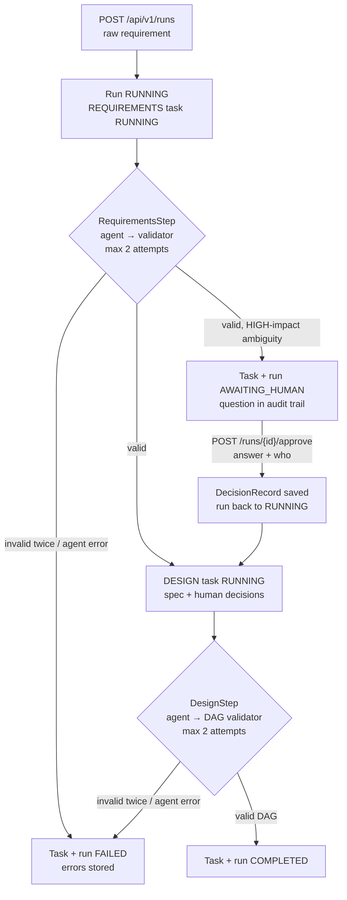

# Agentic SDLC Orchestration

An orchestration layer that takes a plain-English change request through the first
stages of the software lifecycle — **requirements → (human, if needed) → design** —
with validation gates, bounded retries, human approval, decision lineage and a full
audit trail. Every step is persisted, so a run can wait for a person for days and
resume exactly where it stopped.

> Built in Java 21 / Spring Boot 4.1 / Spring AI. The same design maps directly to
> Python (e.g. LangGraph or the Anthropic SDK): stages, validators, state and gates
> are framework-independent.

---

## 1. How a run flows



The **demo moment**: for *"Make the system more scalable"* the requirements agent cannot
know the peak load, so the run stops and asks. Answer *"Plan for 5,000 redirects per
second"* and the design agent receives that answer as a fixed constraint and plans
Redis caching plus a load test. Without the answer, it plans a simple change.
The human's input visibly changes what the AI produces, and the lineage shows why.

---

## 2. Try it (free — stub agents, no API key)

```bash
# 1. start a vague run → stops for a human
curl -s -X POST localhost:8080/api/v1/runs -H 'Content-Type: application/json' \
     -d '{"requirement":"Make the system more scalable"}'
#   → "status":"AWAITING_HUMAN", audit trail asks "What peak load must the system handle?"

# 2. answer the question → run resumes into design
curl -s -X POST localhost:8080/api/v1/runs/<id>/approve -H 'Content-Type: application/json' \
     -d '{"approvedBy":"kazi","decision":"Plan for 5,000 redirects per second"}'
#   → "status":"COMPLETED", DESIGN task output = Redis caching plan, "decisions": [...]

# 3. inspect anything later
curl -s localhost:8080/api/v1/runs/<id>

# a clear request goes straight through both stages
curl -s -X POST localhost:8080/api/v1/runs -H 'Content-Type: application/json' \
     -d '{"requirement":"Add an endpoint that returns total clicks"}'
```

A second `approve`, or approving a run that is not waiting, returns **409 Conflict**.

---

## 3. Components

| Package | What lives there | Role |
|---|---|---|
| `orchestration.agent.requirements` | `RequirementsAgent`, `RequirementSpec`, `Ambiguity`, `RequirementSpecValidator`, `StubRequirementsAgent` | Turn a raw request into intent, functional requirements and ambiguities rated LOW / MEDIUM / HIGH |
| `orchestration.agent.design` | `DesignAgent`, `DesignSpec`, `PlannedTask`, `HumanDecision`, `DesignSpecValidator`, `StubDesignAgent` | Turn the spec + human decisions into a task DAG (`dependsOn`) |
| `orchestration.step` | `RequirementsStep`, `DesignStep`, `StepOutcome`, `StepStatus` | Evaluator-optimizer loop: call agent → validate → feed errors back → bounded retry |
| `orchestration.engine` | `OrchestrationEngine`, `RunView` | Runs stages in order, maps outcomes to state, handles approval and resume |
| `orchestration.run` | `OrchestrationRun`, `TaskExecution`, `StateTransition`, `DecisionRecord` + repositories | Persistent state, append-only audit trail, decision lineage |
| `orchestration.api` | `RunController` | `POST /runs`, `GET /runs/{id}`, `POST /runs/{id}/approve` |

Agents are **interfaces**. The stubs are the default implementation, so tests and demos
are deterministic and cost nothing. `ClaudeRequirementsAgent` (Spring AI `ChatClient`,
structured output into `RequirementSpec`) plugs in behind the same interface without
touching the engine, steps or validators.

### Switching to the real model

```yaml
orchestration.agents.mode: stub     # default: free, deterministic, used by all tests
orchestration.agents.mode: claude   # requirements stage calls Claude; design stays stubbed
```

Exactly one `RequirementsAgent` bean exists at a time (`@ConditionalOnProperty`, with
`matchIfMissing = true` on the stub), so a missing setting can never cause a paid call.
The key is read only from the `ANTHROPIC_API_KEY` environment variable (or `.env` via
Docker Compose); model and `max-tokens` cap live in the base `application.yml`, so every
profile gets the same cost limit.

The model's answer is **not trusted**: it goes through the same validator as the stub's,
and on a retry the validator's errors are appended to the prompt
(*"Your previous answer was rejected by the validator. Fix these problems: …"*).

---

## 4. How the brief's orchestration requirements are met

| Requirement | Where |
|---|---|
| **Dependency graph** | `PlannedTask.dependsOn`; `DesignSpecValidator` rejects unknown ids, duplicates, self-dependencies and cycles (Kahn's algorithm). The topological order is also the execution order. |
| **Gates** | Each stage's validator is a gate: nothing reaches the next stage unvalidated. |
| **Human approval** | HIGH-impact ambiguity → `AWAITING_HUMAN`; `approve` resumes. Guarded against double approval (409). |
| **Bounded retries** | `MAX_ATTEMPTS = 2` per step; validator errors are the feedback. Agent exceptions are not retried (the model client already retries transport errors — no stacked retries). |
| **Audit trail** | `StateTransition`: every status change of the run and each task, with a reason, append-only. |
| **Decision lineage** | `DecisionRecord`: question, answer, who, when — stored as data and passed to later stages. |
| **Statefulness** | All state in Postgres. A waiting run survives restarts; resuming reads the stored spec instead of calling the model again. |
| **Policy guardrails** | Implemented in code, not prompts: validators, max task count, bounded attempts, approval only from `AWAITING_HUMAN`. Concurrency limits for model calls: `AgentConcurrencyLimiter` (built, see limitations). |
| **Observability** | Actuator + Prometheus endpoint; per-run detail via `GET /runs/{id}` (attempts, errors, outputs, trail). |

---

## 5. Key design decisions

**A workflow, not a free-roaming agent.** The engine decides the order of stages; the
model only fills in each stage's output. That makes runs predictable, testable and
auditable — what an SDLC process needs. Autonomy is granted per stage, not globally.

**Guardrails are code, not prompts.** A prompt can ask for a valid plan; only a
validator can guarantee one. Every model output is checked in Java before anything
acts on it.

**Validate first, then decide on a human.** An invalid spec goes back to the model
even if it also contains a HIGH ambiguity — a person should never be asked to
resolve a question inside a malformed answer.

**Humans for missing facts, the model for its own mistakes.** Requirements can stop
for a person because only a person knows business facts (peak load, budget).
Design never escalates a validation error: a cycle or unknown task is the model's
mistake, so it gets precise feedback (`"cycle among tasks: T2, T3"`) and a retry.

**Write state first, then act.** Each task is saved as `RUNNING` before its agent is
called, so a crash mid-call leaves evidence instead of silence.

**Agents get plain records, never entities.** The engine translates `DecisionRecord`
(JPA) into `HumanDecision(question, answer)` at the boundary. Agents stay independent
of persistence, are trivial to unit-test, and nothing internal (ids, lazy links)
leaks into a prompt you pay tokens for.

**Validator messages are written for the model.** They say how to fix the problem
(`"dependsOn must not be null; use [] if there are none"`), because they become the
retry prompt. Precise feedback means fewer retries and lower cost.

---

## 6. Known limitations (deliberate, for scope)

- **First real call failed on response mapping** (empty content). The pipeline handled it
  as designed — the step returned `FAILED` with the error, no retry, no crash — and a
  raw-response diagnostic test located the issue before changing anything.
- **One DB transaction spans the agent call.** Instant with stubs; with a real model
  (seconds) the work should be split so no connection is held while waiting —
  e.g. commit `RUNNING`, call the model outside a transaction, commit the result.
- **No human review gate after design.** Design runs autonomously once requirements
  are settled. Next step: optional `AWAITING_HUMAN` after design, approve or reject
  with a comment; a rejection is stored as a decision and design re-runs with it.
- **Kahn reports blocked tasks, not only the exact cycle.** A task downstream of a
  cycle is listed too. Good enough as retry feedback for ≤ 10 tasks; a DFS would
  isolate the cycle precisely.
- **`AgentConcurrencyLimiter` is built but not yet wired into the steps.** It matters
  once real model calls run in parallel; with stubs there is nothing to limit.
- **No rollback stage.** A failed stage marks the task and run `FAILED` and keeps all
  earlier outputs for inspection; nothing is deleted.
- **The pipeline stops at a plan.** An implementation stage that executes each
  `PlannedTask` (e.g. against the URL shortener's known bugs) is the natural next stage.

---

## 7. What I would add next

1. A model-backed design agent (the requirements agent is done); the prompt passes human
   decisions as fixed constraints.
2. Human review gate after design, with reject-and-replan.
3. Metrics per stage: attempts, retry rate, duration, time spent waiting for humans.
4. An implementation stage that runs the DAG in topological order, parallel where
   independent (virtual threads + `AgentConcurrencyLimiter`).
5. Re-planning: if design fails twice, return to requirements with the errors.

---

## 8. Tests

```bash
mvn clean test      # ~76 tests, no API key, no network calls to a model
```

- Real model: `ClaudeRequirementsAgentIT` runs only when `ANTHROPIC_API_KEY` is set.
  It makes one call and asserts the **contract**, not the wording: the spec passes the
  validator and the vague request is flagged with a HIGH ambiguity.
  `ClaudeRawResponseIT` (disabled by default) prints the raw response for debugging.

- Validators and steps: plain unit tests (`new`, lambda agents) — fast and exact.
- Engine: `@SpringBootTest @Transactional` end-to-end tests for the clear path, the
  human path, the 409 guards, the audit trail and the decision-driven design plan.
