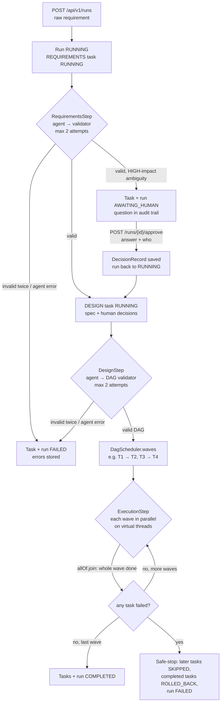

# Agentic SDLC Orchestration

An orchestration layer that takes a plain-English change request through the software
lifecycle — **requirements → (human, if needed) → design → execution** — with validation
gates, bounded retries, human approval, decision lineage, parallel execution with
synchronization, safe-stop and rollback, reliability metrics and a full audit trail. Every step is persisted, so a run can wait for a person for days and
resume exactly where it stopped.

> Built in Java 21 / Spring Boot 4.1 / Spring AI. The same design maps directly to
> Python (e.g. LangGraph or the Anthropic SDK): stages, validators, state and gates
> are framework-independent.

---

## 1. How a run flows



The **demo moment**: for *"Make the system more scalable"* the requirements agent cannot
know the peak load, so the run stops and asks. Answer *"Plan for 5,000 redirects per
second"* and the design agent receives that answer as a fixed constraint and plans
Redis caching plus a load test. Without the answer, it plans a simple change.
The human's input visibly changes what the AI produces, and the lineage shows why.

---

## 2. Try it (free — stub agents, no API key)

Start the stack with `docker compose up -d --build` (the `--build` matters: without it
Docker reuses an older image that may not contain the orchestration endpoints).

```bash
# 1. start a vague run → stops for a human
curl -s -X POST localhost:8080/api/v1/runs -H 'Content-Type: application/json' \
     -d '{"requirement":"Make the system more scalable"}'
#   → "status":"AWAITING_HUMAN", audit trail asks "What peak load must the system handle?"

# 2. answer the question → run resumes into design
curl -s -X POST localhost:8080/api/v1/runs/<id>/approve -H 'Content-Type: application/json' \
     -d '{"approvedBy":"kazi","decision":"Plan for 5,000 redirects per second"}'
#   → "status":"COMPLETED", DESIGN task output = Redis caching plan, "decisions": [...]

# 3. inspect anything later
curl -s localhost:8080/api/v1/runs/<id>

# a clear request goes straight through all stages
curl -s -X POST localhost:8080/api/v1/runs -H 'Content-Type: application/json' \
     -d '{"requirement":"Add an endpoint that returns total clicks"}'
```

### Example output (real run in Docker, stub agents; ids and timestamps shortened)

**1. Start** — `POST /api/v1/runs` with `"Make the system more scalable"` → `201 Created`

```json
{
  "id": "c5b48c7e-…",
  "status": "AWAITING_HUMAN",
  "tasks": [{
    "taskType": "REQUIREMENTS", "status": "AWAITING_HUMAN", "attempts": 1,
    "output": {
      "intent": "Improve the URL shortener's ability to handle more traffic",
      "functionalRequirements": [
        "Cache redirect lookups so most requests skip the database",
        "Keep p99 redirect latency under 50 ms at peak load"
      ],
      "ambiguities": [
        { "question": "What peak load must the system handle?",
          "proposedDefault": "1,000 redirects per second", "impact": "HIGH" },
        { "question": "How long may cached redirects be stale?",
          "proposedDefault": "60 seconds", "impact": "LOW" }
      ]
    }
  }],
  "decisions": []
}
```

The HIGH ambiguity stops the run; the LOW one is settled by its proposed default.

**2. Approve** — `POST /api/v1/runs/c5b48c7e-…/approve` with
`{"approvedBy":"kazi","decision":"Plan for 5,000 redirects per second"}`

```json
{
  "id": "c5b48c7e-…",
  "status": "COMPLETED",
  "tasks": [
    { "taskType": "REQUIREMENTS", "status": "COMPLETED" },
    { "taskType": "DESIGN", "status": "COMPLETED",
      "output": {
        "approach": "Cache short-code lookups in Redis to serve 5,000 redirects/sec",
        "tasks": [
          { "id": "T1", "title": "Add Redis cache for short-code lookups",   "dependsOn": [] },
          { "id": "T2", "title": "Invalidate cache on URL update or expiry", "dependsOn": ["T1"] },
          { "id": "T3", "title": "Add load test for 5,000 redirects/sec",    "dependsOn": ["T1"] },
          { "id": "T4", "title": "Document capacity and cache TTL decision", "dependsOn": ["T2", "T3"] }
        ] } },
    { "taskType": "EXECUTE T1", "status": "COMPLETED",
      "output": { "taskId": "T1", "success": true,
                  "output": "simulated change for T1: Add Redis cache for short-code lookups" } },
    { "taskType": "EXECUTE T2", "status": "COMPLETED", "…": "…" },
    { "taskType": "EXECUTE T3", "status": "COMPLETED", "…": "…" },
    { "taskType": "EXECUTE T4", "status": "COMPLETED", "…": "…" }
  ],
  "decisions": [
    { "question": "What peak load must the system handle?",
      "decision": "Plan for 5,000 redirects per second",
      "decidedBy": "kazi", "decidedAt": "2026-11-22T02:31:25" }
  ]
}
```

The design plan is built from the human's answer (Redis caching and a load test at
5,000/sec), then executed in three waves: `[T1]`, `[T2, T3]` in parallel, `[T4]`.

**3. Audit trail** (from `GET /api/v1/runs/c5b48c7e-…`, the same after a restart)

| Time | Scope | From → To | Reason |
|---|---|---|---|
| 02:27:36.468 | RUN | — → RUNNING | run created |
| 02:27:36.471 | REQUIREMENTS | PENDING → RUNNING | requirements analysis started |
| 02:27:36.484 | REQUIREMENTS | RUNNING → AWAITING_HUMAN | HIGH impact ambiguity: What peak load must the system handle? |
| 02:27:36.485 | RUN | RUNNING → AWAITING_HUMAN | waiting for a person to resolve the ambiguity |
| 02:31:25.270 | REQUIREMENTS | AWAITING_HUMAN → COMPLETED | approved by kazi: Plan for 5,000 redirects per second |
| 02:31:25.271 | RUN | AWAITING_HUMAN → RUNNING | resumed after human approval |
| 02:31:25.283 | DESIGN | PENDING → RUNNING | design started with 1 human decision(s) |
| 02:31:25.290 | DESIGN | RUNNING → COMPLETED | plan validated: 4 tasks |
| 02:31:25.904 | EXECUTE T1 | PENDING → COMPLETED | executed: Add Redis cache for short-code lookups |
| 02:31:25.905 | EXECUTE T2 | PENDING → COMPLETED | executed: Invalidate cache on URL update or expiry |
| 02:31:25.906 | EXECUTE T3 | PENDING → COMPLETED | executed: Add load test for 5,000 redirects/sec |
| 02:31:25.907 | EXECUTE T4 | PENDING → COMPLETED | executed: Document capacity and cache TTL decision |
| 02:31:25.908 | RUN | RUNNING → COMPLETED | all stages completed |

Two things to read from the timestamps:

- **The four-minute gap** (02:27 → 02:31) is the run waiting for a person, with nothing
  held in memory.
- **Execution took ~0.61 s** (25.290 → 25.904) for four tasks of 200 ms each. Run one by
  one they would take 0.8 s; three waves with T2 and T3 in parallel take 0.6 s.
  (Execution rows are recorded together after the last wave — see limitations.)

A clear request needs no person: *"Add an endpoint that returns total clicks"* goes
`RUNNING → COMPLETED` in about 0.6 s with **0 human decisions**, and its plan runs T1 and
T3 together in the first wave.

A second `approve`, or approving a run that is not waiting, returns **409 Conflict**.

---

## 3. Components

| Package | What lives there | Role |
|---|---|---|
| `orchestration.agent.requirements` | `RequirementsAgent`, `RequirementSpec`, `Ambiguity`, `RequirementSpecValidator`, `StubRequirementsAgent` | Turn a raw request into intent, functional requirements and ambiguities rated LOW / MEDIUM / HIGH |
| `orchestration.agent.design` | `DesignAgent`, `DesignSpec`, `PlannedTask`, `HumanDecision`, `DesignSpecValidator`, `StubDesignAgent` | Turn the spec + human decisions into a task DAG (`dependsOn`) |
| `orchestration.step` | `RequirementsStep`, `DesignStep`, `StepOutcome`, `StepStatus` | Evaluator-optimizer loop: call agent → validate → feed errors back → bounded retry |
| `orchestration.execution` | `DagScheduler`, `ExecutionStep`, `TaskExecutor`, `StubTaskExecutor`, `TaskResult`, `ExecutionOutcome` | Groups the plan into waves; runs each wave in parallel on virtual threads; stops safely on failure |
| `orchestration.engine` | `OrchestrationEngine`, `RunView`, `ReliabilityMetricsService` | Runs stages in order, maps outcomes to state, handles approval, resume, safe-stop and rollback; computes reliability metrics |
| `orchestration.run` | `OrchestrationRun`, `TaskExecution`, `StateTransition`, `DecisionRecord` + repositories | Persistent state, append-only audit trail, decision lineage |
| `orchestration.api` | `RunController` | `POST /runs`, `GET /runs/{id}`, `POST /runs/{id}/approve`, `GET /runs/metrics` |

Agents are **interfaces**. The stubs are the default implementation, so tests and demos
are deterministic and cost nothing. `ClaudeRequirementsAgent` (Spring AI `ChatClient`,
structured output into `RequirementSpec`) plugs in behind the same interface without
touching the engine, steps or validators.

### Switching to the real model

```yaml
orchestration.agents.mode: stub     # default: free, deterministic, used by all tests
orchestration.agents.mode: claude   # requirements stage calls Claude; design stays stubbed
```

Exactly one `RequirementsAgent` bean exists at a time (`@ConditionalOnProperty`, with
`matchIfMissing = true` on the stub), so a missing setting can never cause a paid call.
The key is read only from the `ANTHROPIC_API_KEY` environment variable (or `.env` via
Docker Compose); model and `max-tokens` cap live in the base `application.yml`, so every
profile gets the same cost limit.

The model's answer is **not trusted**: it goes through the same validator as the stub's,
and on a retry the validator's errors are appended to the prompt
(*"Your previous answer was rejected by the validator. Fix these problems: …"*).

---

## 4. How the brief's orchestration requirements are met

| Requirement | Where |
|---|---|
| **Dependency graph** | `PlannedTask.dependsOn`; `DesignSpecValidator` rejects unknown ids, duplicates, self-dependencies and cycles (Kahn's algorithm). `DagScheduler.waves` turns the same graph into the execution order. |
| **Sequential and parallel paths with synchronization** | Tasks in a wave run in parallel on virtual threads (`CompletableFuture.supplyAsync`); `allOf().join()` is the barrier, so a task starts only when everything it depends on has finished. `ExecutionStepTest` measures that T2 and T3 overlap and T4 starts after both end. |
| **Safe-stop and rollback** | A failed task stops the run: later tasks are `SKIPPED`, completed tasks are `ROLLED_BACK`, the run is `FAILED` with the reason (`"safe-stop: [T2] failed; skipped [T4]…"`). A crashing worker becomes a failed result, never a crashed run. |
| **Gates** | Each stage's validator is a gate: nothing reaches the next stage unvalidated. |
| **Human approval** | HIGH-impact ambiguity → `AWAITING_HUMAN`; `approve` resumes. Guarded against double approval (409). |
| **Bounded retries** | `MAX_ATTEMPTS = 2` per step; validator errors are the feedback. Agent exceptions are not retried (the model client already retries transport errors — no stacked retries). |
| **Audit trail** | `StateTransition`: every status change of the run and each task, with a reason, append-only. |
| **Decision lineage** | `DecisionRecord`: question, answer, who, when — stored as data and passed to later stages. |
| **Statefulness** | All state in Postgres. A waiting run survives restarts; resuming reads the stored spec instead of calling the model again. |
| **Policy guardrails** | Implemented in code, not prompts: validators, max task count, bounded attempts, approval only from `AWAITING_HUMAN`, and change control — a schema change is a HIGH-impact action that needs a person's approval (brownfield scenario). Concurrency limits for model calls: `AgentConcurrencyLimiter` (built, see limitations). |
| **Reliability metrics** | Success rate, retry rate, rollback frequency, MTTR and end-to-end latency at `GET /api/v1/runs/metrics` (computed from stored runs), plus live Micrometer meters at `/actuator/prometheus`. See section 6. |
| **Observability** | Actuator + Prometheus endpoint; per-run detail via `GET /runs/{id}` (attempts, errors, outputs, trail, decisions). |
| **Three scenarios** | Greenfield, brownfield and ambiguous, each end to end in `ScenarioTest`. See section 5. |

---

## 5. The three scenarios

Each runs end to end in `ScenarioTest` and shows decomposition (the plan), orchestration
(stages, gates, waves) and validation.

| | Request | What happens | What it demonstrates |
|---|---|---|---|
| **Greenfield** | *"Add an endpoint that returns total clicks for a short code"* | Only a LOW ambiguity, so its default is used and no person is needed. Plan: T1 count query, T2 endpoint (after T1), T3 docs, T4 tests (after T2). **T1 and T3 run in parallel** in the first wave. | Decomposition, parallel execution, autonomy inside limits |
| **Brownfield** | *"Fix bug: custom short codes longer than 10 characters fail with a 500"* | A real bug in this codebase: `UrlShortenerService.validateCustomCode` accepts up to 20 characters, but `UrlMapping.shortCode` is a 10-character column. The fix changes the schema, a high-impact action, so the run **stops for change-control approval**. After approval the plan names the impacted modules and the data flow (`POST /api/v1/shorten → UrlShortenerController → validateCustomCode → saveWithRetry → url_mappings`). | Codebase reasoning, human approval for high-impact actions, change control |
| **Ambiguous** | *"Make the system more scalable"* | Stops for a **missing business fact** (peak load). The answer is stored as a decision; the design plan changes because of it (Redis cache + load test at 5,000/sec). | Ambiguity handling, decision lineage, cross-stage context |

The two human gates stop for different reasons: the ambiguous request needs a **fact only a
person knows**; the brownfield fix needs a **risky action a person must approve**. Both use
the same mechanism (a HIGH-impact ambiguity, then `approve`).

---

## 6. Reliability metrics

`GET /api/v1/runs/metrics` — computed from stored runs, so they survive restarts and agree
with the audit trail:

```json
{ "totalRuns": 3, "completed": 1, "failed": 1, "awaitingHuman": 1,
  "successRate": 0.5, "retryRate": 0.0, "rollbackFrequency": 0.5,
  "mttrSeconds": 0.06, "avgEndToEndSeconds": 0.4 }
```

| Metric | Definition |
|---|---|
| Success rate | completed ÷ (completed + failed) |
| Retry rate | stage tasks that needed a second attempt ÷ stage tasks |
| Rollback frequency | finished runs that rolled work back ÷ finished runs |
| MTTR | from a `FAILED` run until the next `COMPLETED` run of the same requirement |
| End-to-end latency | run created → `COMPLETED`/`FAILED`, including time waiting for a person |

No data gives `null`, not `0` — "no runs yet" is not "0% success".

Live meters for dashboards and alerting (`/actuator/prometheus`):
`orchestration_stage_duration_seconds{stage}`, `orchestration_runs_total{outcome}`,
`orchestration_stage_retries_total{stage}`, `orchestration_execution_rollbacks_total`.
Tags have a small fixed set of values (stage, outcome) — never run ids, which would
explode cardinality.

---

## 7. Key design decisions

**A workflow, not a free-roaming agent.** The engine decides the order of stages; the
model only fills in each stage's output. That makes runs predictable, testable and
auditable — what an SDLC process needs. Autonomy is granted per stage, not globally.

**Guardrails are code, not prompts.** A prompt can ask for a valid plan; only a
validator can guarantee one. Every model output is checked in Java before anything
acts on it.

**Validate first, then decide on a human.** An invalid spec goes back to the model
even if it also contains a HIGH ambiguity — a person should never be asked to
resolve a question inside a malformed answer.

**Humans for missing facts, the model for its own mistakes.** Requirements can stop
for a person because only a person knows business facts (peak load, budget).
Design never escalates a validation error: a cycle or unknown task is the model's
mistake, so it gets precise feedback (`"cycle among tasks: T2, T3"`) and a retry.

**Write state first, then act.** Each task is saved as `RUNNING` before its agent is
called, so a crash mid-call leaves evidence instead of silence.

**Agents get plain records, never entities.** The engine translates `DecisionRecord`
(JPA) into `HumanDecision(question, answer)` at the boundary. Agents stay independent
of persistence, are trivial to unit-test, and nothing internal (ids, lazy links)
leaks into a prompt you pay tokens for.

**Workers compute, the engine records.** Execution tasks run on virtual threads, but
worker threads never touch JPA: they return a `TaskResult`, and the engine thread records
every status change after each wave. No entity or transaction is ever shared across threads.

**Fail-fast inside one change set.** The planned tasks together form one change, so a
failure stops the run and rolls back what completed — shipping the cache without its
invalidation would be worse than shipping nothing. For independent work (e.g. fetching
data for many symbols) the right policy is the opposite: skip only the failed task's
transitive dependents and keep going (Maven's fail-at-end). It is a per-run policy choice.

**Validator messages are written for the model.** They say how to fix the problem
(`"dependsOn must not be null; use [] if there are none"`), because they become the
retry prompt. Precise feedback means fewer retries and lower cost.

---

## 8. Known limitations (deliberate, for scope)

- **First real call failed on response mapping** (empty content). The pipeline handled it
  as designed — the step returned `FAILED` with the error, no retry, no crash — and a
  raw-response diagnostic test located the issue before changing anything.
- **One DB transaction spans the agent call.** Instant with stubs; with a real model
  (seconds) the work should be split so no connection is held while waiting —
  e.g. commit `RUNNING`, call the model outside a transaction, commit the result.
- **No human review gate after design.** Design runs autonomously once requirements
  are settled. Next step: optional `AWAITING_HUMAN` after design, approve or reject
  with a comment; a rejection is stored as a decision and design re-runs with it.
- **Kahn reports blocked tasks, not only the exact cycle.** A task downstream of a
  cycle is listed too. Good enough as retry feedback for ≤ 10 tasks; a DFS would
  isolate the cycle precisely.
- **`AgentConcurrencyLimiter` is built but not yet wired into the steps.** It matters
  once real model calls run in parallel; with stubs there is nothing to limit.
- **Execution is simulated.** `StubTaskExecutor` returns a result shaped like real work;
  the orchestration around it (waves, threads, barrier, safe-stop, rollback, audit) is real.
  A model-backed executor would propose a diff on a branch and use the test suite as its
  validator. Likewise `ROLLED_BACK` is a recorded state; real rollback would revert that branch.
- **Waves, not fully dependency-driven scheduling.** A fast task can't start its own
  dependents until its whole wave is done. Simpler and enough for ≤ 10 tasks; a per-task
  scheduler would remove that wait.
- **The audit trail records each execution task's final status**, not the moment it
  started. A progress callback from the worker would add per-task start times.
- **Metrics read every run.** Fine for a prototype; at production volume they become
  aggregate SQL over a time window. Definitions stay the same.
- **Local Postgres needs a reset after this upgrade.** `ddl-auto: update` does not change
  the check constraint Hibernate created for the old task statuses, so existing tables
  reject `SKIPPED`/`ROLLED_BACK`: `docker compose down -v && docker compose up -d --build`.
  A real deployment would use versioned migrations (Flyway or Liquibase).

---

## 9. What I would add next

1. A model-backed design agent (the requirements agent is done); the prompt passes human
   decisions as fixed constraints.
2. Human review gate after design, with reject-and-replan.
3. A model-backed `TaskExecutor`: propose a diff per task on a branch, validate with the
   test suite, and wire `AgentConcurrencyLimiter` around the parallel model calls.
4. Re-planning: if design fails twice, or upstream outputs change, return to the earlier
   stage with the errors or the new input.
5. Per-run failure policy: fail-fast (today) or fail-at-end for independent tasks.
6. Versioned schema migrations (Flyway) instead of `ddl-auto: update`.

---

## 10. Tests

```bash
mvn clean test      # ~91 tests, no API key, no network calls to a model
```

- Real model: `ClaudeRequirementsAgentIT` runs only when `ANTHROPIC_API_KEY` is set.
  It makes one call and asserts the **contract**, not the wording: the spec passes the
  validator and the vague request is flagged with a HIGH ambiguity.
  `ClaudeRawResponseIT` (disabled by default) prints the raw response for debugging.

- Validators and steps: plain unit tests (`new`, lambda agents) — fast and exact.
- Engine: `@SpringBootTest @Transactional` end-to-end tests for the clear path, the
  human path, the 409 guards, the audit trail and the decision-driven design plan.
- Execution: `DagSchedulerTest` (waves), `ExecutionStepTest` with real virtual threads —
  measures that tasks in a wave overlap and the next wave waits for all of them —
  and `ExecutionSafeStopTest` (T2 fails → T4 skipped, T1 and T3 rolled back, run failed).
- `ScenarioTest`: greenfield, brownfield and ambiguous, end to end.
- `ReliabilityMetricsTest`: a failure, a recovery and a human wait, then every metric checked.
